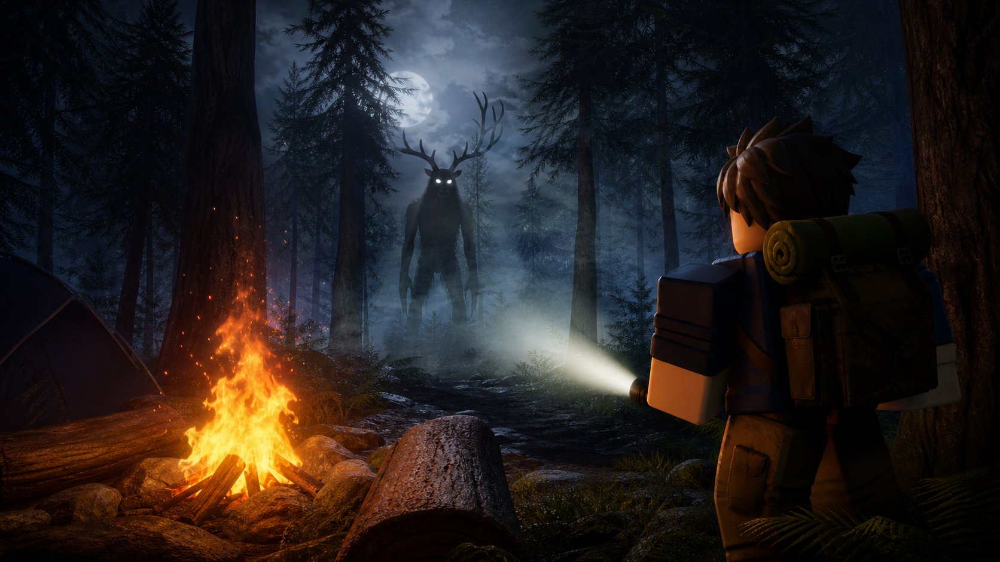

# KLIK — Free Browser Gaming Arcade

A Poki/CrazyGames-style game portal with **15 hand-built HTML5 games**, including the flagship
survival-horror game **99 Nights in the Forest**. Everything runs instantly in the browser — no
installs, no accounts, no ads.



## ✨ Features

- **Instant play storefront** — rotating spotlight carousel, trending rail, search with live results,
  genre chips, favorites and “jump back in” recents (stored in `localStorage`).
- **Game player page** — full screen 16:9 play area, fullscreen mode, how-to-play/controls panel,
  shareable deep links (`#game-id`), related games rail and ESC-to-exit.
- **15 original games** — each written from scratch in TypeScript + Canvas/React (no third-party game code).
- **Procedural sound design** — all SFX generated with the Web Audio API, with a global mute toggle.
- Fully responsive, dark neon aesthetic, zero tracking.

## 🎮 The games

| Game | Genre | Highlights |
| --- | --- | --- |
| **99 Nights in the Forest** | Survival horror | Day/night loop, campfire fuel, crafting (traps/torches/medkits/batteries), flashlight beam that burns the Wendigo, 4 children to rescue, night multiplier to 99 |
| SkyBlox Parkour | Platformer | Procedural sky course, lava, bounce pads, checkpoints, double jump + dash |
| Cyber Drift GT | Racing | Pseudo-3D synthwave highway, traffic, near-miss combos, nitro |
| Astro Survivors | Roguelite | Auto-firing bullet-heaven, XP gems, 9 upgrade evolutions, bosses |
| Neon Slither Arena | .io | AI serpents, orbs, boost, leaderboard, minimap |
| Dungeon Forge Merge | Puzzle | 2048-style weapon merging that damages dungeon bosses |
| Zombie Siege Defense | Tower defense | 3 turret types, upgrades, escalating zombie waves |
| Turbo Street Hoops | Sports | Drag-to-shoot physics, swish streaks, shot clock |
| Neon Prism Breaker | Arcade | Breakout with multiball / wide paddle / extra-life powerups |
| Crystal Mine Tycoon | Idle | Clicker economy, 6 generators, frenzies, golden meteors |
| Shadow Katana Runner | Runner | Endless rooftop sprint, double jump, drone slicing |
| Cyber Pong Duel | 2 player | Local 2P keyboard duel or adaptive AI |
| Neon Block Blitz | Puzzle | Tetris with ghost piece, hard drop, speed levels |
| Quantum Minesweeper | Puzzle | 3 difficulties, safe first click, flags, timer |
| Holo Memory Matrix | Puzzle | 6/8/10 pair boards, combo streaks, best time |

## 🕹 Controls for 99 Nights in the Forest

| Keys | Action |
| --- | --- |
| `WASD` / arrows | Move |
| Mouse aim + left click | Swing axe (chop trees, forage, attack) |
| `Space` / right click | Toggle flashlight beam |
| `E` | Feed the campfire / rescue a child |
| `R` | Eat a berry ration |
| `1`–`4` | Craft spike trap / torch / medkit / battery |

Touch devices get an on-screen joystick, axe button, flashlight toggle and feed/eat buttons.

## 🚀 Development

```bash
npm install
npm run dev      # http://localhost:5173
npm run build    # production build in dist/
npm run preview  # preview the build
```

## 🗂 Project structure

```
src/
  App.tsx                 # storefront shell (hero, filters, grids, footer)
  components/             # Navbar, Hero, GameCard, GamePlayer, ui atoms
  data/games.ts           # game catalogue metadata
  games/                  # 15 game implementations + engine helpers + registry
  utils/sound.ts          # Web Audio SFX engine
  hooks/useLocal.ts       # localStorage state hook
public/images/            # game cover art
```

## 📝 Notes

*99 Nights in the Forest* on Klik is an **original fan-inspired re-imagining** of the survival-horror
genre concept — all code, artwork and audio in this repository are created from scratch for this
project. Every game is self-contained and works offline after the first load.
